# CNN própria x ResNet18 no MNIST e no CIFAR-10

**Uma rede convolucional treinada do zero comparada com uma ResNet18 pré-treinada no ImageNet.**

PyTorch · CNN própria · ResNet18 · MNIST · CIFAR-10 · Grad-CAM

Repositório: [soninhoxs/APS_CNN_MNIST_CIFAR10](https://github.com/soninhoxs/APS_CNN_MNIST_CIFAR10)

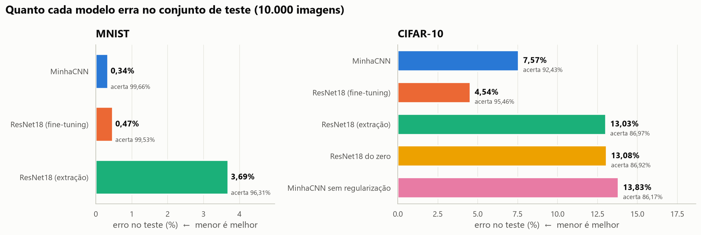

_Teste — no MNIST a MinhaCNN erra 0,34% e a ResNet18 com fine-tuning 0,47%. No CIFAR-10 a ResNet18 erra 4,54% e a MinhaCNN 7,57%._

---

## Sobre o projeto

Atividade Prática Supervisionada da disciplina **Introdução à Aprendizagem Profunda**. O código implementa uma CNN própria, a **MinhaCNN**, treinada do zero com regularização, e a compara com a **ResNet18** pré-treinada no ImageNet, no MNIST e no CIFAR-10. Todos os modelos seguem o mesmo protocolo: a escolha do checkpoint é feita na validação e o conjunto de teste entra uma vez, no fim.

A entrega pede um documento com a comparação, a justificativa dos resultados e propostas de melhoria. O relatório está em [`relatorio/Relatorio_APS_CNN.pdf`](relatorio/Relatorio_APS_CNN.pdf) (também em [DOCX](relatorio/Relatorio_APS_CNN.docx) e [Markdown](relatorio/relatorio.md)). O desafio pede a visualização das ativações dos kernels; ele está na seção 7 do relatório e no fim deste README.

### Problema

Uma CNN pequena, treinada só com as imagens do próprio dataset, compete com uma rede maior que já viu 1,28 milhão de fotos? E, se perde, a diferença vem da arquitetura ou do pré-treino?

O MNIST é quase resolvido por qualquer CNN; o CIFAR-10 não. Imagens de 32×32 com fundo variado e classes parecidas (gato e cachorro, automóvel e caminhão) exigem regularização: uma rede treinada do zero decora as 45 mil imagens de treino em poucas épocas.

### Solução

* **CNN própria no estilo VGG** — três blocos de duas convoluções 3×3 (64 → 128 → 256 filtros), Batch Normalization, max-pooling, Global Average Pooling e uma cabeça MLP. 1,18 M de parâmetros.
* **Regularização** — Dropout2d nos blocos, dropout 0,3 na cabeça, weight decay 5e-4, label smoothing 0,1 e aumento de dados na GPU. No CIFAR-10: recorte com padding de 4 px e espelhamento. No MNIST: rotação de 10°, translação de 8% e escala de 0,9 a 1,1, sem espelhamento.
* **Rede pré-treinada em três usos** — ResNet18 (`IMAGENET1K_V1`) em 224×224 com fine-tuning completo, como extratora de características (backbone congelado) e treinada do zero como controle.
* **Ablação** — a mesma MinhaCNN sem aumento de dados, dropout, weight decay e label smoothing.
* **Comparação com estatística** — intervalo de confiança de 95% e teste de McNemar sobre as mesmas 10 mil imagens de teste.
* **Desafio** — kernels da primeira camada, mapas de ativação, maximização de ativação, imagens que mais ativam cada neurônio e Grad-CAM.

---

## Arquitetura

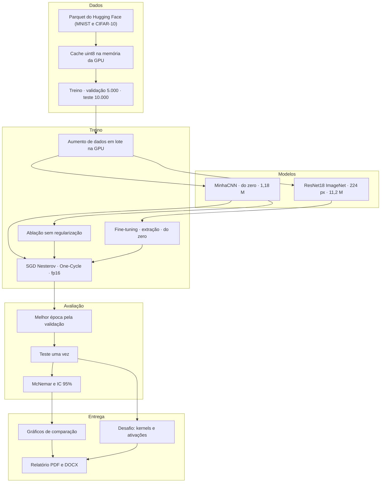

Fluxo: os Parquets são decodificados uma vez e guardados como `uint8`. Cada experimento carrega o dataset inteiro na GPU e aplica o aumento de dados em lote, ali mesmo. A MinhaCNN recebe a imagem no tamanho original. A ResNet18 recebe a imagem ampliada para 224×224, com o MNIST replicado em três canais e a normalização do ImageNet. Cada época é avaliada na validação; o melhor checkpoint é o único avaliado no teste.

### MinhaCNN

| Bloco | Camadas | Saída (CIFAR-10) | Parâmetros |
| --- | --- | ---: | ---: |
| 1 | 2× [conv 3×3, 64 + BN + ReLU] · max-pool · Dropout2d 0,1 | 64×16×16 | 38.848 |
| 2 | 2× [conv 3×3, 128 + BN + ReLU] · max-pool · Dropout2d 0,1 | 128×8×8 | 221.696 |
| 3 | 2× [conv 3×3, 256 + BN + ReLU] · max-pool · Dropout2d 0,2 | 256×4×4 | 885.760 |
| Cabeça | GAP · linear 256→128 + BN + ReLU · dropout 0,3 · linear 128→10 | 10 | 34.314 |
| **Total** | | | **1.180.618** |

No MNIST a entrada tem um canal (28×28 → 14 → 7 → 3) e o total cai para 1.179.466.

### Divisão dos dados

| Conjunto | MNIST | CIFAR-10 |
| --- | ---: | ---: |
| Treino | 55.000 | 45.000 |
| Validação | 5.000 | 5.000 |
| Teste | 10.000 | 10.000 |

A validação sai do treino oficial, sorteada com seed 0. O teste é o split oficial e não entra no treino nem na escolha do checkpoint.

---

## Decisões de engenharia

**Dados na GPU e aumento em lote.** Os dois datasets cabem na memória da GPU (cerca de 55 MB e 180 MB em `uint8`). O recorte, o espelhamento e as transformações afins são feitos em lote, na própria GPU. Isso elimina o DataLoader, que no Windows abre um processo por worker. Uma época da MinhaCNN leva 8 s.

**Sem `channels_last`.** Nesta GPU, o formato `channels_last` deixou o treino 7× mais lento na MinhaCNN (800 contra 5.500 imagens/s) e 8× na ResNet18 (62 contra 490). O código usa o formato padrão NCHW.

**GAP no lugar de achatar.** Achatar o mapa 256×4×4 levaria mais de 500 mil pesos para a cabeça densa. Com Global Average Pooling são 33 mil, e a média espacial já regulariza.

**Sem espelhamento no MNIST.** Espelhar um dígito muda o que ele significa. O aumento cobre o que varia na escrita: inclinação, posição e tamanho.

**Controle "ResNet18 do zero".** Comparar só a MinhaCNN com a ResNet18 pré-treinada mistura duas variáveis: arquitetura e pré-treino. A mesma ResNet18, na mesma resolução e com as mesmas 5 épocas, mas com pesos aleatórios, separa as duas.

**Escolha antes do teste.** O checkpoint de cada experimento é o de maior acurácia na validação. O teste é avaliado uma vez, com esse checkpoint. Os números oficiais não foram escolhidos depois de olhar o teste.

**CIFAR-10 conferido por hash.** O servidor de Toronto estava lento, então os dados vieram do espelho oficial no Hugging Face (`uoft-cs/cifar10`). A versão binária de Toronto também foi baixada e comparada: são as mesmas 60 mil imagens e rótulos. O teste é idêntico até na ordem; o treino só está em outra ordem.

**Weight decay só nos pesos.** O decaimento L2 vale para convoluções e camadas lineares. Ganhos e vieses da BN ficam de fora.

---

## Destaques técnicos

| Área | Implementação |
| --- | --- |
| **Arquiteturas** | MinhaCNN (estilo VGG, 1,18 M) e ResNet18 pré-treinada no ImageNet (11,2 M) |
| **Transfer learning** | Fine-tuning completo, extração de características e controle do zero |
| **Regularização** | BN, Dropout2d, dropout, weight decay, label smoothing e aumento de dados |
| **Treino** | SGD com Nesterov, One-Cycle, precisão mista fp16 |
| **Avaliação** | Acurácia, F1 macro, matriz de confusão, acurácia por classe, IC 95% e McNemar |
| **Desafio** | Kernels, mapas de ativação, maximização de ativação, top imagens e Grad-CAM |
| **Gráficos** | seaborn + matplotlib: escalas lineares, valores escritos nas curvas e no mesmo eixo entre painéis |
| **Relatório** | Markdown convertido em DOCX e PDF por script próprio |
| **Hardware** | RTX 3050 Laptop (6 GB); a execução completa leva cerca de 50 minutos |

---

## Resultados

| Dataset | Modelo | Parâmetros | Épocas | Acurácia no teste | F1 macro | Acurácia no treino | Gap | Treino | Inferência (img/s) |
| --- | --- | ---: | ---: | ---: | ---: | ---: | ---: | ---: | ---: |
| MNIST | MinhaCNN | 1,18 M | 15 | **99,66%** | 0,9966 | 99,82% | 0,2 p.p. | 2,1 min | 25.064 |
| MNIST | ResNet18 (fine-tuning) | 11,18 M | 3 | 99,53% | 0,9953 | 99,71% | 0,2 p.p. | 5,8 min | 1.573 |
| MNIST | ResNet18 (extração) | 11,18 M | 5 | 96,31% | 0,9627 | 96,59% | 0,3 p.p. | 3,8 min | 1.571 |
| CIFAR-10 | MinhaCNN | 1,18 M | 40 | 92,43% | 0,9240 | 98,16% | 5,7 p.p. | 6,1 min | 19.235 |
| CIFAR-10 | ResNet18 (fine-tuning) | 11,18 M | 5 | **95,46%** | 0,9545 | 98,68% | 3,2 p.p. | 8,0 min | 1.567 |
| CIFAR-10 | ResNet18 (extração) | 11,18 M | 5 | 86,97% | 0,8691 | 88,55% | 1,6 p.p. | 2,8 min | 1.568 |
| CIFAR-10 | ResNet18 do zero | 11,18 M | 5 | 86,92% | 0,8686 | 89,62% | 2,7 p.p. | 7,9 min | 1.568 |
| CIFAR-10 | MinhaCNN sem regularização | 1,18 M | 40 | 86,17% | 0,8616 | 100,00% | 13,8 p.p. | 6,0 min | 19.043 |

_Acurácia no treino é medida sem aumento de dados nem dropout. Gap é a diferença entre ela e a acurácia de teste. Na extração de características só 5.130 parâmetros são treinados._

No **MNIST**, a MinhaCNN erra 34 imagens e a ResNet18 com fine-tuning, 47. A diferença é pequena e fica no limite da significância (McNemar, p = 0,041). O problema está praticamente resolvido pelas duas.

No **CIFAR-10**, a ResNet18 com fine-tuning erra 40% menos que a MinhaCNN (McNemar, p < 0,001). A vantagem vem do ImageNet, não da arquitetura: a mesma ResNet18 treinada do zero fica em 86,92%, abaixo da MinhaCNN. O ganho se concentra nos animais — pássaro (+7,6 p.p.), gato (+5,9 p.p.) e cachorro (+3,4 p.p.) —, classes que o ImageNet cobre com centenas de categorias.

A MinhaCNN é 9,5× menor e classifica 12× mais imagens por segundo. A regularização vale 6,3 pontos para ela:

| MinhaCNN no CIFAR-10 | Teste | Treino | Gap | Perda de teste |
| --- | ---: | ---: | ---: | ---: |
| Com regularização | **92,43%** | 98,16% | **5,7 p.p.** | **0,303** |
| Sem regularização | 86,17% | 100,00% | 13,8 p.p. | 0,765 |

Sem regularização a rede chega a 100% no treino em cerca de 20 épocas e a validação para em 87%.

---

## Galeria

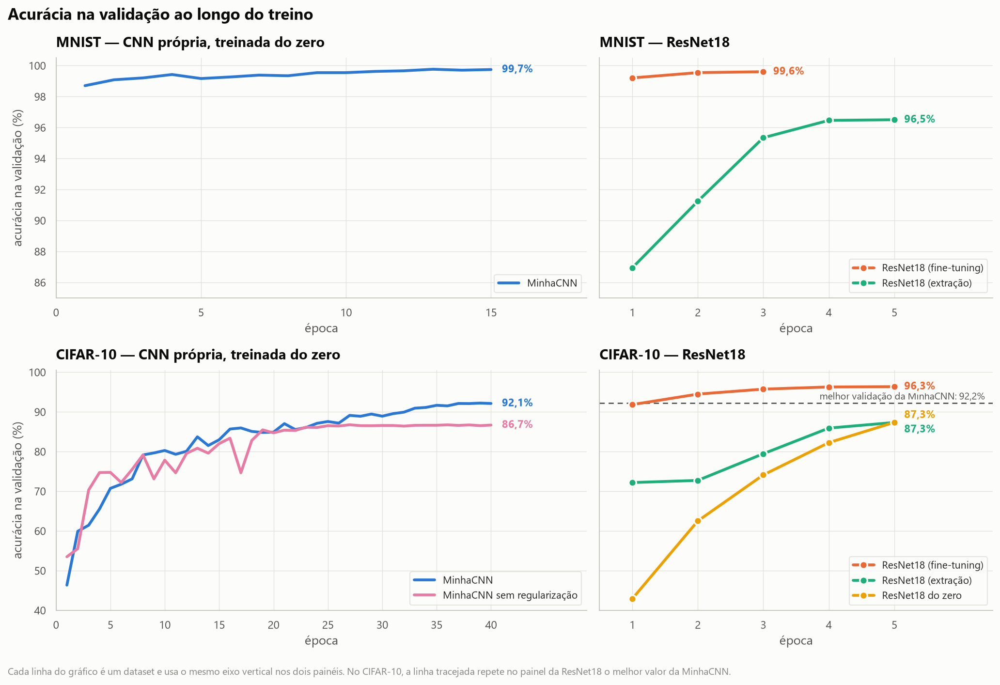

_**Curvas de validação** — CNNs próprias à esquerda e ResNet18 à direita, com o mesmo eixo vertical. A ResNet18 pré-treinada passa de 91% de validação no CIFAR-10 já na primeira época. A MinhaCNN leva cerca de 25 épocas para chegar a 87% e ainda melhorava na época 40._

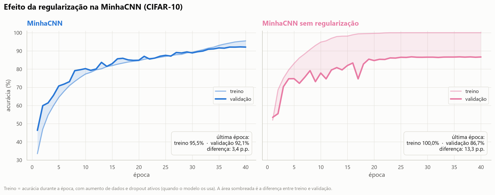

_**Ablação** — sem regularização, o treino chega a 100% e a validação para em 87%: a área sombreada mostra a diferença de 13 p.p. Com regularização, treino e validação andam juntos._

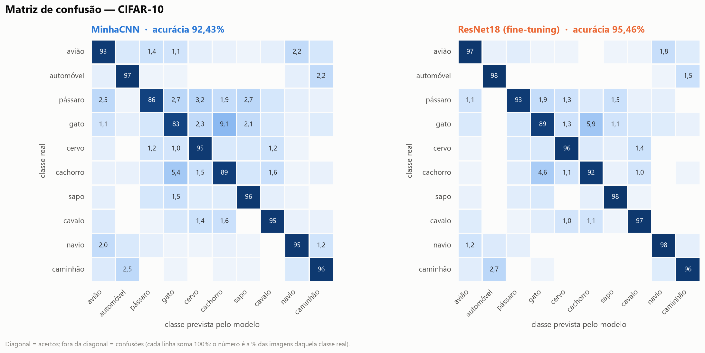

_**Matrizes de confusão** — a confusão mais frequente nas duas redes é gato → cachorro (9,1% dos gatos na MinhaCNN). Depois vêm automóvel ↔ caminhão e avião ↔ navio._

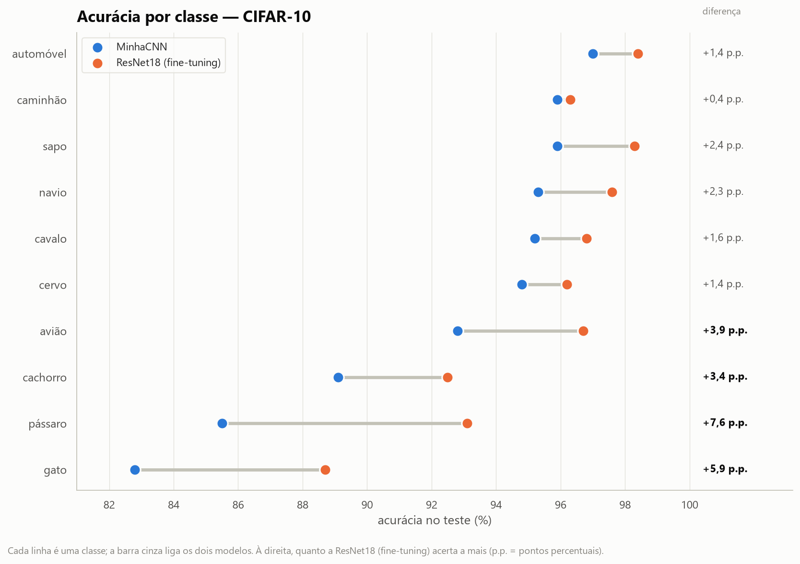

_**Acurácia por classe** — gato, pássaro e cachorro são as classes mais difíceis para os dois modelos. À direita, quanto a ResNet18 acerta a mais em cada classe: o ganho maior está nos animais._

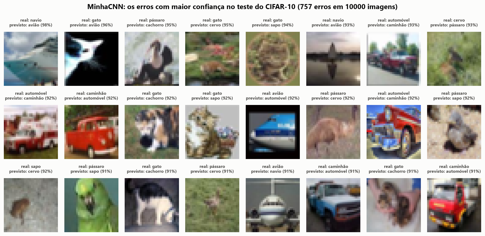

_**Erros da MinhaCNN** — os 24 erros com maior confiança. Muitos são ambíguos a 32×32 pixels: um navio contra o céu, uma picape vermelha, um animal camuflado no fundo._

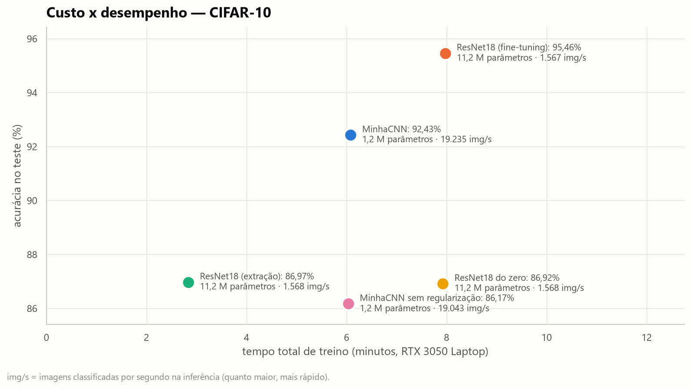

_**Custo x desempenho** — a ResNet18 converge em poucas épocas, então o tempo total de treino fica parecido. A inferência continua 12× mais lenta._

### Desafio: o que os neurônios aprendem

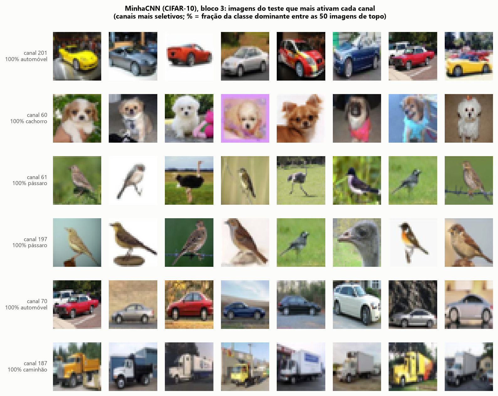

_**Top imagens do bloco 3** — para cada canal, as 8 imagens do teste com maior ativação. Há canais que respondem só a carros, a rostos de cachorro, a pássaros e a caminhões. Na média dos 256 canais, 75,8% das 50 imagens de topo são da mesma classe._

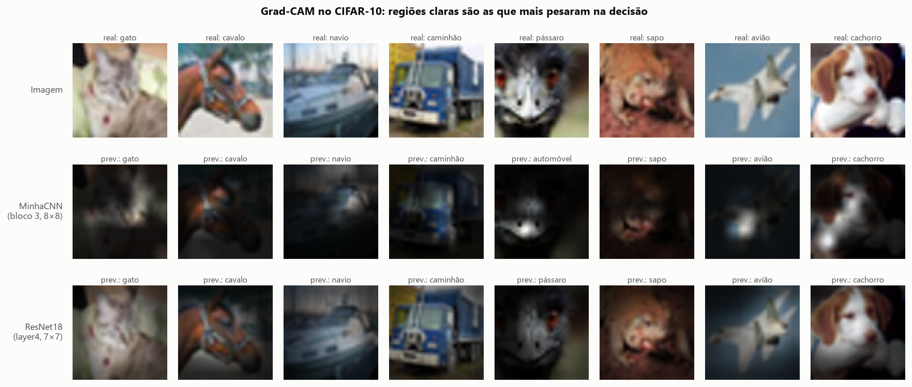

_**Grad-CAM** — regiões claras pesaram mais na decisão. A MinhaCNN usa pontos pequenos (olho e cabresto do cavalo, focinho do cachorro). A ResNet18 usa o objeto inteiro._

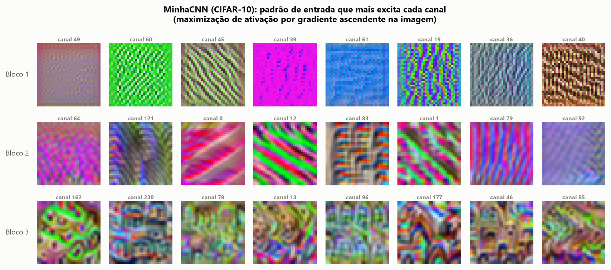

_**Maximização de ativação** — imagens sintetizadas por gradiente ascendente. Bloco 1: cores e bordas orientadas. Bloco 2: listras e texturas. Bloco 3: padrões que lembram partes de objetos._

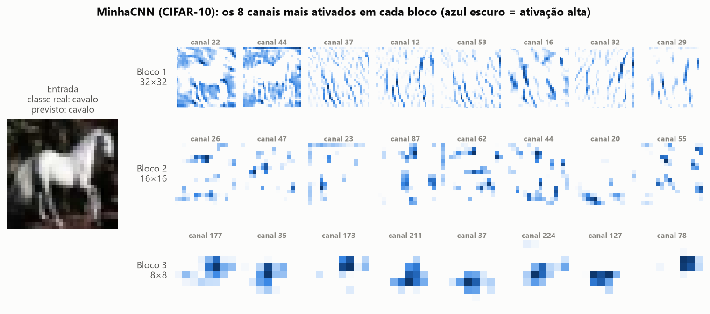

_**Mapas de ativação** — os 8 canais mais ativos de cada bloco para um cavalo. A resolução cai de 32×32 para 8×8 e as respostas ficam esparsas e localizadas no objeto._

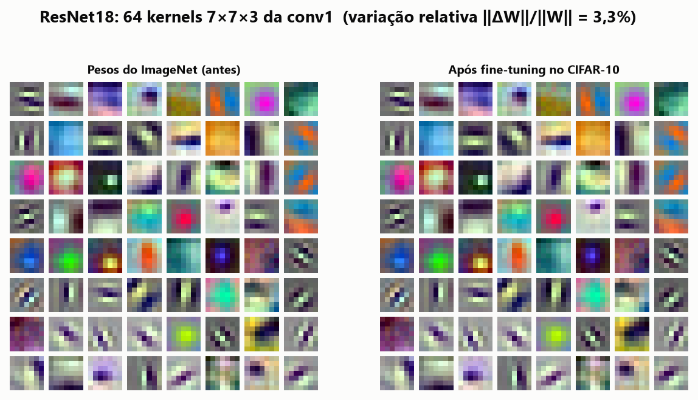

_**Kernels da conv1 da ResNet18** — filtros de borda orientada e de cor oponente. O fine-tuning mudou esses pesos em só 3,3%: as primeiras camadas do ImageNet servem quase sem ajuste._

---

## Como executar

Pré-requisitos: Python 3.11 e PyTorch com CUDA. O ambiente usado aqui foi o conda `coco_nlp` (torch 2.7.1 + CUDA 12.6).

```bash
git clone https://github.com/soninhoxs/APS_CNN_MNIST_CIFAR10.git
cd APS_CNN_MNIST_CIFAR10
pip install -r requirements.txt
```

Os dados não vão no repositório. O script baixa o [MNIST](https://huggingface.co/datasets/ylecun/mnist) e o [CIFAR-10](https://huggingface.co/datasets/uoft-cs/cifar10) do Hugging Face para `data/raw/`. Se existir `data/raw/cifar10/cifar-10-batches-bin/` sem o Parquet, o código usa a versão binária de [Toronto](https://www.cs.toronto.edu/~kriz/cifar.html).

```bash
python download_data.py
python run_all.py
python -m src.make_report
```

`run_all.py` treina os 8 experimentos, gera os gráficos em `figures/` e as visualizações do desafio. Os resultados de cada experimento ficam em `results/<experimento>/` e os logs em `logs/`. Com GPU, a passagem completa fica na casa dos 50 minutos. `make_report` regenera o DOCX e o PDF a partir de `relatorio/relatorio.md` (o PDF usa o Microsoft Edge em modo headless).

Para rodar um experimento isolado:

```bash
python -m src.train --dataset cifar10 --model minhacnn --epochs 40 --lr 0.1 --tag minhacnn_cifar10
python -m src.train --dataset cifar10 --model resnet18 --epochs 5 --lr 0.01 --wd 1e-4 --tag resnet18_ft_cifar10
```

No Windows com Anaconda, o numpy (MKL) e o PyTorch trazem cada um sua cópia da runtime OpenMP, e o matplotlib aborta com `OMP: Error #15`. O pacote `src` já define `KMP_DUPLICATE_LIB_OK=TRUE` para contornar.

---

## Estrutura do repositório

```
├── run_all.py               # roda os 8 experimentos, os gráficos e o desafio
├── download_data.py         # baixa MNIST e CIFAR-10 para data/raw/
├── requirements.txt
├── src/
│   ├── data.py              # leitura, divisão e aumento de dados na GPU
│   ├── models.py            # MinhaCNN e ResNet18
│   ├── train.py             # treino e avaliação de um experimento
│   ├── plots.py             # gráficos, tabela-resumo e McNemar
│   ├── activations.py       # desafio: kernels, ativações e Grad-CAM
│   ├── style.py             # paleta e estilo dos gráficos
│   └── make_report.py       # relatorio.md -> DOCX e PDF
├── results/                 # métricas, histórico e predições de cada experimento
├── figures/                 # gráficos em PNG
├── logs/                    # saída de cada treino
├── relatorio/
│   ├── Relatorio_APS_CNN.pdf
│   ├── Relatorio_APS_CNN.docx
│   └── relatorio.md
└── README.md
```

---

## Contato

APS de Introdução à Aprendizagem Profunda: redes convolucionais no MNIST e no CIFAR-10.

GitHub: [@soninhoxs](https://github.com/soninhoxs)
