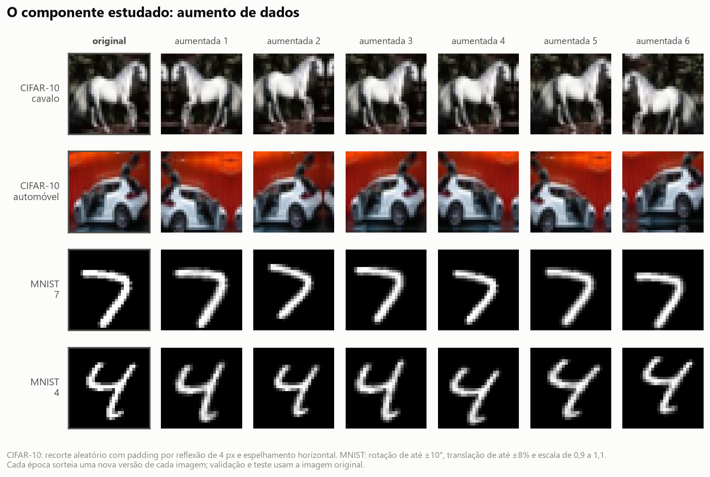
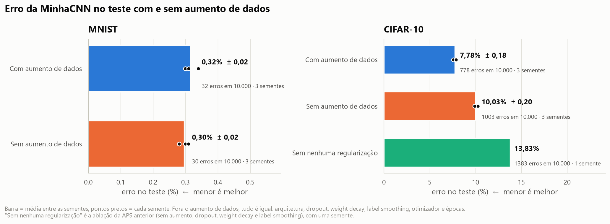
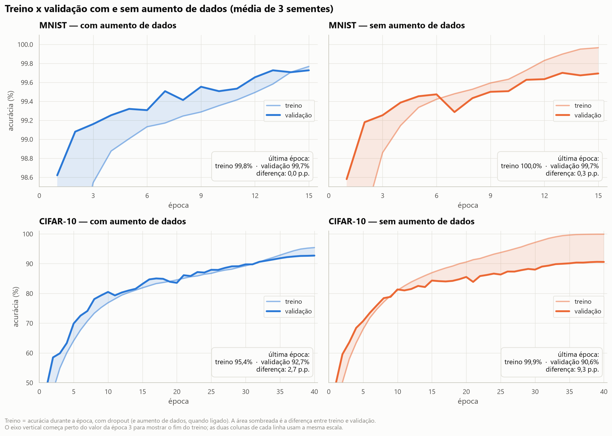
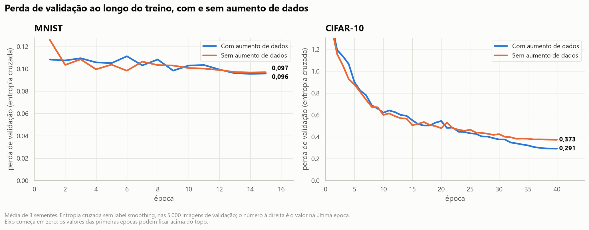
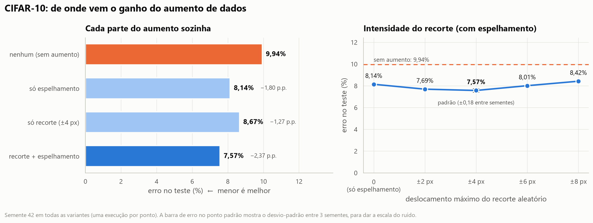
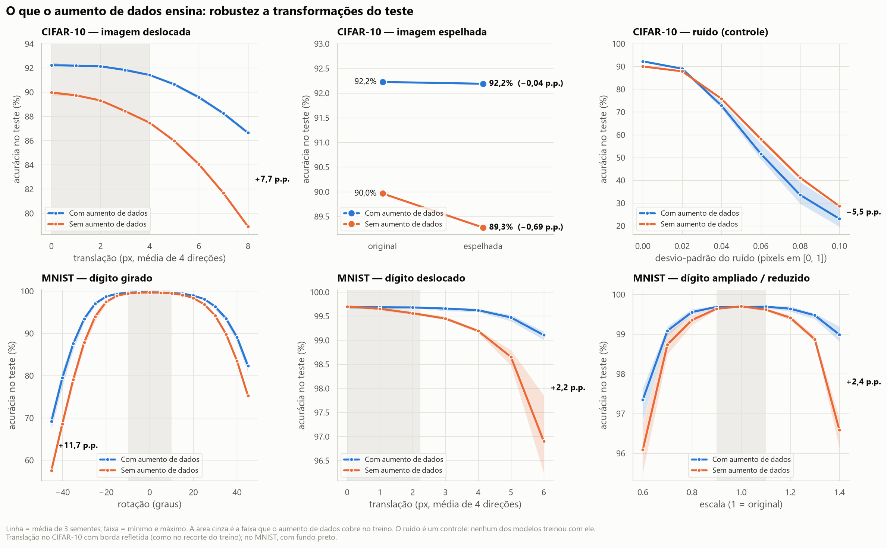
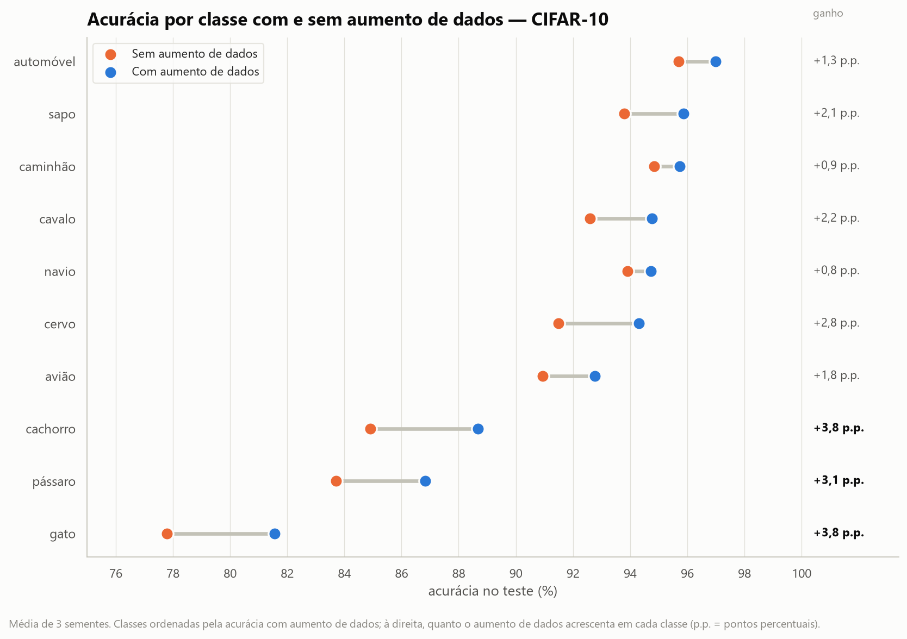

# Estudo de ablação: o aumento de dados na MinhaCNN (MNIST e CIFAR-10)

{{subtitle}}Introdução à Aprendizagem Profunda — Atividade Prática Supervisionada (APS)

{{subtitle}}Estudo de Ablação — continuação da APS de Redes Convolucionais

{{subtitle}}**Integrante:** João Henrique dos Santos Silva

{{subtitle}}**Repositório:** https://github.com/soninhoxs/APS_CNN_MNIST_CIFAR10

{{subtitle}}Outubro de 2026

{{pagebreak}}

## Resumo

Fizemos um estudo de ablação do **aumento de dados** (*data augmentation*) na MinhaCNN, a CNN própria da APS anterior. Treinamos a mesma rede com e sem esse componente, mantendo todo o resto igual, com 3 sementes por configuração e as mesmas métricas da APS anterior.

- **Componente escolhido:** o aumento de dados — recorte aleatório e espelhamento no CIFAR-10; rotação, translação e escala no MNIST.
- **CIFAR-10:** com aumento de dados a MinhaCNN acerta **92,22% ± 0,18**; sem ele, **89,97% ± 0,20**. São 22% menos erros (778 contra 1.003 em 10.000), e a diferença é significativa em todas as sementes (McNemar, p < 10⁻¹³). Sem o componente a rede decora o treino (100% de acerto) e a diferença entre treino e teste sobe de 6,0 para 10,0 pontos percentuais. Ele explica 38% da queda que a APS anterior atribuía à "regularização" como um todo.
- **MNIST:** **99,68%** com e **99,70%** sem — empate (p ≥ 0,58 em todas as sementes). O aumento de dados não melhora o teste do MNIST, que já vem centralizado e normalizado, mas torna a rede robusta a dígitos girados, deslocados e ampliados: +7 a +12 p.p. com rotação de 45° e +2,2 p.p. com 6 px de deslocamento.
- **Análise (desafio):** no CIFAR-10, o espelhamento sozinho rende +1,8 p.p. e o recorte sozinho +1,3; os dois juntos, +2,4. A melhor intensidade do recorte fica entre ±2 e ±4 px. O ganho é maior nos animais (gato e cachorro, +3,8 p.p.). E é específico: contra ruído gaussiano, transformação que nenhum modelo viu no treino, os modelos com aumento de dados foram *menos* robustos.
- **Nossa opinião:** no CIFAR-10 o componente é essencial e quase não custa nada — não acrescenta parâmetros, não muda a inferência e deixa a época cerca de 5% mais lenta. No MNIST ele não melhora a acurácia, mas vale pela robustez. Em nenhum dos dois casos ele é "regularização genérica": funciona porque descreve as variações que o problema realmente tem, e por isso precisa ser escolhido para cada problema.

## 1. Qual o componente escolhido?

Escolhemos o **aumento de dados** (*data augmentation*) usado no treino da MinhaCNN, a CNN de 1,18 milhão de parâmetros da APS anterior. A cada época, cada imagem de treino passa por uma transformação aleatória antes de entrar na rede; validação e teste usam sempre a imagem original.

- **CIFAR-10:** recorte aleatório de 32×32 depois de acrescentar 4 pixels de borda refletida (o objeto se desloca até 4 px em cada direção) e espelhamento horizontal com probabilidade 0,5.
- **MNIST:** rotação de até ±10°, translação de até ±8% da largura (±2,2 px) e escala de 0,9 a 1,1. Não há espelhamento: um dígito espelhado deixa de ser o mesmo dígito.

Recorte e espelhamento são o aumento de dados clássico das CNNs desde a AlexNet (Krizhevsky et al., 2012); pequenas transformações afins em dígitos manuscritos já eram usadas por Simard et al. (2003).

Por que este componente:

1. **A APS anterior deixou a pergunta em aberto.** Lá, a MinhaCNN sem regularização perdeu 6,3 pontos percentuais (p.p.) no CIFAR-10 (92,43% → 86,17%). Mas aquela ablação desligou quatro técnicas de uma vez (aumento de dados, dropout, weight decay e label smoothing) e não dizia quanto vinha de cada uma. Isolar uma delas é o passo seguinte natural.
2. **É o único regularizador que mexe nos dados, não no modelo.** Dropout, weight decay e label smoothing restringem a rede; o aumento de dados acrescenta conhecimento sobre o problema: "um gato deslocado ou espelhado continua sendo um gato". É a técnica que esperávamos ser a mais importante, e uma ablação serve justamente para testar essa expectativa.
3. **A ablação é limpa.** Ligar e desligar o aumento de dados não muda a arquitetura, o número de parâmetros nem o custo de inferência. A única diferença entre os modelos comparados é o que eles viram no treino — a condição que um estudo de ablação precisa para atribuir o efeito ao componente (Meyes et al., 2019).

**Hipóteses, escritas antes dos resultados:** (H1) sem o aumento de dados o erro de teste sobe bastante no CIFAR-10 e pouco no MNIST, que já está perto do limite; (H2) sem ele, a rede decora o treino e a diferença entre treino e teste cresce; (H3) o ganho vem da robustez às transformações usadas no treino (deslocamento, espelhamento, rotação), e não de uma robustez geral — um modelo treinado com aumento de dados não deveria ser mais robusto a ruído, transformação que ele nunca viu.

## 2. Protocolo experimental

Usamos o mesmo conjunto de dados, a mesma divisão e as mesmas métricas da APS anterior. **Só o aumento de dados muda** entre as duas configurações:

| Item | Com aumento de dados | Sem aumento de dados |
|---|---|---|
| Arquitetura | MinhaCNN, 1,18 M parâmetros | igual |
| Batch Normalization | sim | sim |
| Dropout espacial / dropout na cabeça | 0,1 · 0,1 · 0,2 / 0,3 | igual |
| Weight decay | 5×10⁻⁴ | igual |
| Label smoothing | 0,1 | igual |
| Otimização | SGD Nesterov, One-Cycle até 0,1, lotes de 128, fp16 | igual |
| Épocas | 15 (MNIST) e 40 (CIFAR-10) | igual |
| **Aumento de dados** | **recorte + espelhamento (CIFAR-10); rotação, translação e escala (MNIST)** | **nenhum** |
| Sementes | 42, 43, 44 | 42, 43, 44 |

- **Dados:** treino de 55.000 (MNIST) e 45.000 (CIFAR-10) imagens, validação de 5.000 sorteadas do treino oficial com semente fixa e o teste oficial de 10.000 imagens.
- **Seleção de modelo:** o checkpoint de cada execução é a época de maior acurácia na validação; o teste é avaliado uma vez, com esse checkpoint.
- **Métricas (as da APS anterior):** acurácia e F1 macro no teste, acurácia no treino medida sem aumento de dados e sem dropout, *gap* (treino − teste), perda de teste (entropia cruzada), acurácia por classe, intervalo de confiança de 95% e teste de McNemar entre os modelos.
- **Repetições:** cada configuração principal foi treinada com **3 sementes**, para separar o efeito do componente da variação natural entre treinos. A semente 42 com aumento de dados é o próprio modelo da APS anterior (mesmo código e mesmos hiperparâmetros), reaproveitado sem retreinar.
- **Experimentos complementares (CIFAR-10, semente 42):** cada parte do aumento sozinha (só espelhamento; só recorte) e a intensidade do recorte (±0, 2, 4, 6 e 8 px, sempre com espelhamento).
- **Testes de robustez (sem treino novo):** os 12 modelos principais foram avaliados no teste transformado — deslocado, espelhado, girado, ampliado/reduzido — e, como controle, com ruído gaussiano.

Ao todo foram 15 treinos novos, cerca de 75 minutos de GPU numa RTX 3050 Laptop (6 GB).

## 3. Quais os resultados com e sem o componente?

### 3.1 Resultado principal

| Dataset | Configuração | Acurácia teste | Erros (de 10.000) | F1 macro | Acc. treino | Gap | Perda teste |
|---|---|---:|---:|---:|---:|---:|---:|
| MNIST | **Com aumento de dados** | 99,68% ± 0,02 | 32 ± 2 | 0,9968 | 99,84% | 0,15 p.p. | 0,097 |
| MNIST | Sem aumento de dados | **99,70% ± 0,02** | 30 ± 2 | 0,9970 | 99,97% | 0,26 p.p. | 0,097 |
| CIFAR-10 | **Com aumento de dados** | **92,22% ± 0,18** | **778 ± 18** | **0,9219** | 98,19% | **5,96 p.p.** | **0,303** |
| CIFAR-10 | Sem aumento de dados | 89,97% ± 0,20 | 1.003 ± 20 | 0,8992 | 100,00% | 10,03 p.p. | 0,389 |
| CIFAR-10 | Sem nenhuma regularização (APS anterior) | 86,17% | 1.383 | 0,8616 | 100,00% | 13,83 p.p. | 0,765 |

_Média ± desvio-padrão de 3 sementes (42, 43 e 44); a última linha tem uma semente. Acc. treino é medida no treino sem aumento de dados e sem dropout; gap = acc. treino − acc. teste. Valores de cada semente em `results/ablacao/resumo_ablacao.csv`._

**No CIFAR-10 o componente faz muita diferença.** Sem o aumento de dados a acurácia cai 2,26 p.p. (92,22% → 89,97%) e o número de erros sobe de 778 para 1.003: tirar o componente faz a rede errar 29% a mais. A queda é dez vezes maior que a variação entre sementes (desvio-padrão de 0,2 p.p.) e as três sementes "sem" ficaram abaixo das três "com". O teste de McNemar compara os dois modelos imagem a imagem, nas mesmas 10.000 fotos:

| Dataset | Semente | Só o modelo com aumento acerta | Só o modelo sem aumento acerta | p (McNemar) |
|---|---:|---:|---:|---:|
| CIFAR-10 | 42 | 485 | 248 | 1,4 × 10⁻¹⁸ |
| CIFAR-10 | 43 | 486 | 247 | 7,3 × 10⁻¹⁹ |
| CIFAR-10 | 44 | 451 | 250 | 2,8 × 10⁻¹⁴ |
| MNIST | 42 | 13 | 17 | 0,58 |
| MNIST | 43 | 11 | 13 | 0,84 |
| MNIST | 44 | 12 | 12 | 1,00 |

No CIFAR-10, em cada semente, as imagens que só o modelo com aumento de dados acerta são quase o dobro das que só o modelo sem ele acerta. O teste t de Welch sobre as três sementes dá o mesmo veredito (p = 0,0001).

**No MNIST não há diferença.** As médias diferem 0,02 p.p. (2 imagens em 10.000) a favor do modelo *sem* aumento de dados, bem dentro do ruído: o intervalo de confiança de 95% de uma acurácia de 99,7% em 10.000 imagens é de ±0,11 p.p., e nenhum McNemar chega perto de ser significativo (p ≥ 0,58). A hipótese H1 se confirmou, com um MNIST ainda mais saturado do que esperávamos: ali o componente não ajuda nem atrapalha a acurácia de teste. A seção 4.2 mostra o que ele muda no MNIST.

### 3.2 Sobreajuste: o que acontece no treino

Sem aumento de dados, a MinhaCNN **decora o CIFAR-10**: a acurácia de treino chega a 100,00% nas três sementes, enquanto a de teste fica em 90%. Não é surpresa: redes desse porte conseguem decorar até rótulos sorteados ao acaso (Zhang et al., 2017). O gap dobra para 10,0 p.p., contra 6,0 com o componente — hipótese H2 confirmada. Com aumento de dados a rede quase nunca vê a mesma versão de uma imagem duas vezes; depois de 40 épocas ela acerta 98,2% do treino limpo e a melhor época de validação é a última (época 40 em duas das três sementes): ela ainda estava aprendendo quando o treino acabou.

No MNIST o efeito é pequeno: sem aumento de dados a rede chega a 99,97% no treino e o gap passa de 0,15 para 0,26 p.p., mas a validação fica igual. O MNIST tem 55 mil imagens de um problema simples, e o dropout, o weight decay e o label smoothing já seguram o sobreajuste.

A perda de validação conta a mesma história. No CIFAR-10 as duas curvas andam juntas por cerca de 25 épocas e depois se separam: sem aumento de dados a perda de validação passa a cair bem mais devagar, enquanto a rede continua melhorando no treino até decorá-lo (99% de acerto no treino por volta da época 33). A perda não chega a subir, como subia no modelo sem nenhuma regularização da APS anterior (perda de teste de 0,765): o label smoothing, o dropout e o weight decay, que continuam ligados, impedem que a rede fique confiante demais nos erros.

### 3.3 Quanto da "regularização" da APS anterior é aumento de dados

| MinhaCNN no CIFAR-10 (semente 42) | Acurácia teste | Queda acumulada |
|---|---:|---:|
| Com todas as técnicas de regularização | 92,43% | — |
| Sem aumento de dados (dropout, weight decay e label smoothing ligados) | 90,06% | −2,37 p.p. |
| Sem nenhuma regularização | 86,17% | −6,26 p.p. |

A APS anterior mediu que a regularização valia 6,3 p.p. no CIFAR-10. Tirar só o aumento de dados custa 2,4 desses pontos: **38% da queda**. Os outros 62% vêm de dropout, weight decay e label smoothing juntos. O aumento de dados é importante, mas não é a única técnica que importa.

## 4. Por que o componente faz diferença (desafio)

Os gráficos desta seção mostram de onde vem a influência do componente: qual parte do aumento de dados rende mais, quanto aumentar e o que exatamente a rede aprende com ele.

### 4.1 Cada parte do aumento de dados e a intensidade do recorte

| CIFAR-10 (semente 42) | Acurácia teste | Ganho sobre "nenhum" | Acc. treino | Gap |
|---|---:|---:|---:|---:|
| Nenhum aumento | 90,06% | — | 100,00% | 9,94 p.p. |
| Só espelhamento | 91,86% | +1,80 p.p. | 99,88% | 8,02 p.p. |
| Só recorte (±4 px) | 91,33% | +1,27 p.p. | 99,79% | 8,46 p.p. |
| Recorte ±2 px + espelhamento | 92,31% | +2,25 p.p. | 98,68% | 6,37 p.p. |
| **Recorte ±4 px + espelhamento (padrão)** | **92,43%** | **+2,37 p.p.** | 98,16% | 5,73 p.p. |
| Recorte ±6 px + espelhamento | 91,99% | +1,93 p.p. | 97,40% | 5,41 p.p. |
| Recorte ±8 px + espelhamento | 91,58% | +1,52 p.p. | 96,87% | 5,29 p.p. |

_Uma execução por linha. Como referência, o desvio-padrão entre sementes da configuração padrão é 0,18 p.p.: diferenças menores que ~0,4 p.p. nesta tabela não são confiáveis._

- **As duas partes ajudam, e o espelhamento ajuda mais.** Sozinho, o espelhamento rende +1,8 p.p.; o recorte, +1,3 p.p. Isso faz sentido no CIFAR-10: um carro ou um cavalo virado para a esquerda é tão comum quanto um virado para a direita, e espelhar dobra a variedade de poses sem criar nada irreal.
- **As partes se sobrepõem.** Juntas elas rendem +2,4 p.p., menos que a soma das duas separadas (+3,1 p.p.). Parte do que cada uma faz é o mesmo: impedir que a rede decore as imagens exatas do treino. Com uma parte só, a rede ainda acerta 99,8–99,9% do treino; com as duas, 98,2%.
- **Mais intensidade não é sempre melhor.** O erro é menor entre ±2 e ±4 px e volta a subir com ±6 e ±8 px. O gap cai sempre que o recorte aumenta (de 8,0 para 5,3 p.p.), mas a acurácia de treino também cai (de 99,9% para 96,9%): com deslocamentos de 8 px numa imagem de 32 px, parte do objeto sai do quadro e a borda refletida cria imagens estranhas. Com o mesmo número de épocas, o aumento forte demais passa a atrapalhar o aprendizado, e a rede deixa de aprender o que precisa (*underfitting*). O padrão de ±4 px, que é o usual para o CIFAR-10, ficou no ponto certo.

### 4.2 O que o aumento de dados ensina: robustez

A acurácia no teste original só mostra parte do efeito. Para ver o que a rede aprendeu, avaliamos os 12 modelos principais no conjunto de teste **transformado**: deslocado, espelhado, girado, ampliado ou reduzido. Como **controle**, usamos ruído gaussiano, transformação que nenhum dos modelos viu no treino.

| Teste transformado | Com aumento | Sem aumento | Diferença |
|---|---:|---:|---:|
| CIFAR-10 original | 92,22% | 89,96% | +2,3 p.p. |
| CIFAR-10 espelhado | 92,19% | 89,27% | +2,9 p.p. |
| CIFAR-10 deslocado 4 px | 91,41% | 87,47% | +3,9 p.p. |
| CIFAR-10 deslocado 8 px | 86,64% | 78,91% | +7,7 p.p. |
| CIFAR-10 com ruído σ = 0,06 (controle) | 51,63% | 58,10% | **−6,5 p.p.** |
| MNIST original | 99,68% | 99,70% | −0,02 p.p. |
| MNIST girado 45° | 82,27% | 75,22% | +7,1 p.p. |
| MNIST girado −45° | 69,20% | 57,54% | +11,7 p.p. |
| MNIST deslocado 6 px | 99,11% | 96,90% | +2,2 p.p. |
| MNIST ampliado 1,4× | 98,99% | 96,58% | +2,4 p.p. |
| MNIST com ruído σ = 0,2 (controle) | 62,56% | 76,53% | **−14,0 p.p.** |

_Média de 3 sementes. Deslocamento = média das 4 direções; no CIFAR-10 com borda refletida (como no recorte do treino) e no MNIST com fundo preto. σ é o desvio-padrão do ruído, com pixels entre 0 e 1._

- **Espelhamento.** O modelo treinado com espelhamento é indiferente à orientação (92,22% → 92,19%). O modelo sem aumento de dados perde 0,7 p.p. quando a imagem é espelhada: parte do que ele acerta depende de o objeto estar virado para um lado específico, um detalhe que não tem nada a ver com a classe.
- **Deslocamento.** As CNNs já têm alguma tolerância a deslocamentos por causa da convolução e do *pooling*, mas não é completa (Azulay e Weiss, 2019). Com 8 px de deslocamento, o modelo sem aumento de dados perde 11,1 p.p.; o modelo com aumento, 5,6 p.p. — metade.
- **MNIST.** Aqui está o valor do componente no MNIST. Dentro da faixa vista no treino (±10°, ±2,2 px, escala de 0,9 a 1,1) os dois modelos praticamente empatam (diferenças de até 0,2 p.p.), porque o teste do MNIST já vem centralizado e normalizado em tamanho, igual ao treino. Fora dela, o modelo com aumento de dados é muito mais robusto: +7 a +12 p.p. a 45° de rotação, +2,2 p.p. com 6 px de deslocamento e +2,4 p.p. com o dígito 40% maior. Numa aplicação real, em que o dígito não vem centralizado, essa é a diferença que aparece.
- **Ruído (controle).** Com ruído gaussiano, os modelos **com** aumento de dados foram *menos* robustos nos dois datasets (−6,5 p.p. no CIFAR-10 com σ = 0,06 e −14,0 p.p. no MNIST com σ = 0,2; nas três sementes, sem sobreposição). A hipótese H3 se confirmou de forma mais forte do que esperávamos: o aumento de dados não traz robustez geral, só às transformações que ele mostra no treino, e pode até piorar a robustez a outras. Não investigamos a causa. Outros trabalhos já mostraram que ganhar robustez a um tipo de perturbação pode custar robustez a outro (Yin et al., 2019); para resistir a ruído, a receita seria incluir ruído no próprio aumento de dados (Hendrycks e Dietterich, 2019).

### 4.3 Onde o ganho aparece: acurácia por classe

O aumento de dados melhora **todas** as 10 classes do CIFAR-10. O ganho é maior justamente nas classes mais difíceis, os animais: gato (77,8% → 81,6%) e cachorro (84,9% → 88,7%) ganham 3,8 p.p. cada, pássaro 3,1 e cervo 2,8. Nos veículos o ganho fica entre 0,8 e 1,8 p.p. Animais aparecem em mais poses, posições e enquadramentos do que veículos; o recorte e o espelhamento multiplicam justamente essas variações. Entre os pares mais confundidos, o efeito é desigual: a confusão gato → cachorro, a mais frequente na APS anterior, quase não muda (91 → 90 imagens por semente), mas a contrária, cachorro → gato, cai 23% (76 → 59). As classes que mais ganham com o aumento de dados são as mesmas em que a ResNet18 pré-treinada levava mais vantagem na APS anterior. Nos dois casos, o que falta à MinhaCNN treinada do zero é ver mais variações dos animais.

## 5. Qual nossa opinião sobre o impacto do componente?

**No CIFAR-10, o aumento de dados é um componente essencial da MinhaCNN.** Ele vale 2,3 p.p. de acurácia (22% menos erros), reduz o sobreajuste pela metade e melhora todas as classes, com resultados consistentes nas três sementes. E quase não custa nada: não acrescenta parâmetros, não muda a velocidade de inferência e deixa cada época de treino cerca de 5% mais lenta (8,4–8,8 s contra 8,2–8,3 s), porque as transformações rodam na GPU.

**Mas não é "o" componente da regularização.** Ele explica 38% da queda que a APS anterior via ao desligar toda a regularização. Os outros 62% vêm de dropout, weight decay e label smoothing. Esperávamos uma fatia maior; a ablação mostrou que a MinhaCNN depende do conjunto de técnicas, não de uma só.

**No MNIST, ele não melhora a acurácia de teste — e nós o manteríamos assim mesmo.** O teste do MNIST tem as mesmas condições do treino (dígitos centralizados e do mesmo tamanho), então ensinar a rede a lidar com rotações e deslocamentos não muda o placar. Mas o modelo com aumento de dados é bem mais robusto a dígitos girados, deslocados ou de outro tamanho, que é o que acontece fora do conjunto de dados. Se fôssemos julgar só pela tabela de acurácia, concluiríamos errado que o componente é inútil no MNIST.

**O aumento de dados funciona porque é conhecimento sobre o problema, não porque é regularização genérica.** Cada transformação diz à rede o que *não* muda a classe (Shorten e Khoshgoftaar, 2019): espelhar um gato continua sendo um gato, mas espelhar um "2" não é mais um "2" — por isso não usamos espelhamento no MNIST. Os experimentos mostram os dois lados: o ganho aparece exatamente nas transformações treinadas, transformações fortes demais (recorte de ±8 px) passam a atrapalhar, e o componente não protege contra o que não foi treinado (ruído). Nossa conclusão é que o aumento de dados deve ficar na MinhaCNN, escolhido de acordo com as variações que o problema realmente tem.

**O que faríamos a seguir:**

1. **Treinar por mais tempo com o aumento de dados.** A melhor época foi a última e a rede ainda não tinha chegado a 100% no treino; sem o aumento, ela passou de 99% no treino por volta da época 33 e daí em diante só decorou. Quanto mais longo o treino, mais o componente tende a render.
2. **Testar aumentos mais fortes de outro tipo, em vez de recortes maiores.** O recorte já chegou ao ponto ótimo. *Cutout*, RandAugment ou *mixup* atacam outras variações (oclusão, cor, contraste) e são o próximo passo natural (DeVries e Taylor, 2017; Cubuk et al., 2020).
3. **Incluir ruído, se a robustez a ruído importar.** O controle mostrou que ela não vem de graça.
4. **Usar o espelhamento também no teste** (*test-time augmentation*): como o modelo é indiferente à orientação, a média das previsões da imagem original e da espelhada sai quase de graça.

## 6. Limitações

- **Sementes.** As configurações principais têm 3 sementes cada; as variantes da seção 4.1 têm uma só. Diferenças abaixo de ~0,4 p.p. entre variantes estão dentro do ruído (desvio-padrão de 0,18–0,20 p.p. entre sementes).
- **Mesmo número de épocas.** Todas as configurações usaram 40 épocas no CIFAR-10 e 15 no MNIST. Com o aumento de dados a rede converge mais devagar; com treinos mais longos o ganho do componente provavelmente seria maior e a intensidade ideal do recorte poderia mudar.
- **Um componente por vez.** Não medimos as interações entre o aumento de dados e as outras técnicas de regularização. A conta de 38% da seção 3.3 depende da ordem: desligamos primeiro o aumento de dados e depois as outras três.
- **Tempo de treino.** O treino "CIFAR-10 sem aumento, semente 42" dividiu a GPU com outra tarefa por alguns minutos, por isso o tempo dele (12,5 min) não é comparável; a acurácia não é afetada. Os tempos por época citados vêm das outras sementes.

## 7. Reprodutibilidade

O estudo de ablação está no mesmo repositório da APS anterior, na branch `ablacao-aumento-dados`:

| Arquivo | Função |
|---|---|
| `ablacao_aumento_de_dados.ipynb` | notebook executado com o estudo completo: comandos de treino, tabelas, testes estatísticos e gráficos |
| `run_ablation.py` | lista os 15 treinos da ablação, executa os que faltam e roda a análise |
| `src/train.py` | treino de um experimento; ganhou as opções `--no-aug`, `--crop-pad`, `--no-flip` e `--subdir` |
| `src/data.py` | aumento de dados na GPU; `make_augment` aceita a intensidade do recorte e liga/desliga o espelhamento |
| `src/ablation.py` | tabelas, estatística, testes de robustez e figuras do estudo |
| `results/ablacao/` | métricas, histórico e predições de cada treino; `resumo_ablacao.csv`, `estatistica_ablacao.json` e `robustez.json` |
| `figures/ablacao_*.png` | as figuras deste documento |
| `logs/ablacao/` | saída de cada treino |

Para reproduzir: `python download_data.py`, `python run_all.py` (APS anterior, que gera a semente 42 com aumento) e `python run_ablation.py`. Para refazer só a análise: `python -m src.ablation`. Este documento é gerado com `python -m src.make_report --src relatorio/ablacao.md --out Relatorio_Ablacao_CNN`.

## Referências

- AZULAY, A.; WEISS, Y. Why Do Deep Convolutional Networks Generalize So Poorly to Small Image Transformations? JMLR, 20, 2019.
- CUBUK, E. D. et al. RandAugment: Practical Automated Data Augmentation with a Reduced Search Space. NeurIPS, 2020.
- DEVRIES, T.; TAYLOR, G. W. Improved Regularization of Convolutional Neural Networks with Cutout. arXiv:1708.04552, 2017.
- HENDRYCKS, D.; DIETTERICH, T. Benchmarking Neural Network Robustness to Common Corruptions and Perturbations. ICLR, 2019.
- KRIZHEVSKY, A.; SUTSKEVER, I.; HINTON, G. E. ImageNet Classification with Deep Convolutional Neural Networks. NeurIPS, 2012.
- MEYES, R. et al. Ablation Studies in Artificial Neural Networks. arXiv:1901.08644, 2019.
- SHORTEN, C.; KHOSHGOFTAAR, T. M. A Survey on Image Data Augmentation for Deep Learning. Journal of Big Data, 6, 60, 2019.
- SIMARD, P. Y.; STEINKRAUS, D.; PLATT, J. C. Best Practices for Convolutional Neural Networks Applied to Visual Document Analysis. ICDAR, 2003.
- YIN, D. et al. A Fourier Perspective on Model Robustness in Computer Vision. NeurIPS, 2019.
- ZHANG, C. et al. Understanding Deep Learning Requires Rethinking Generalization. ICLR, 2017.
