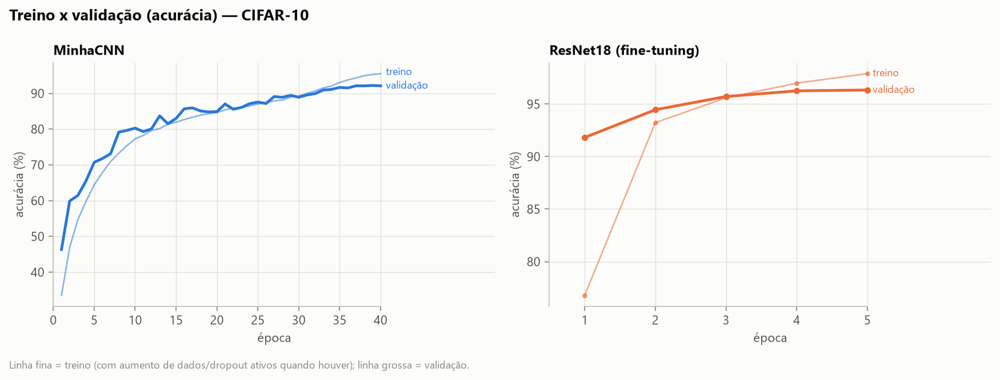
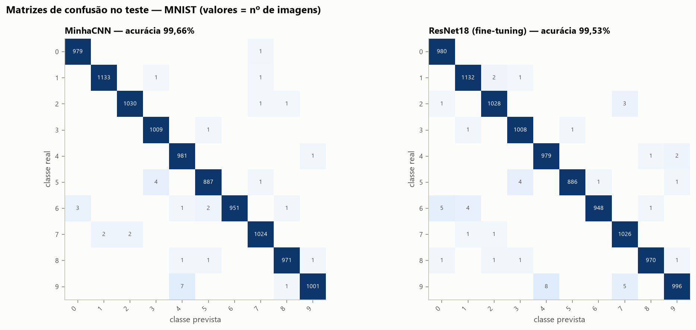
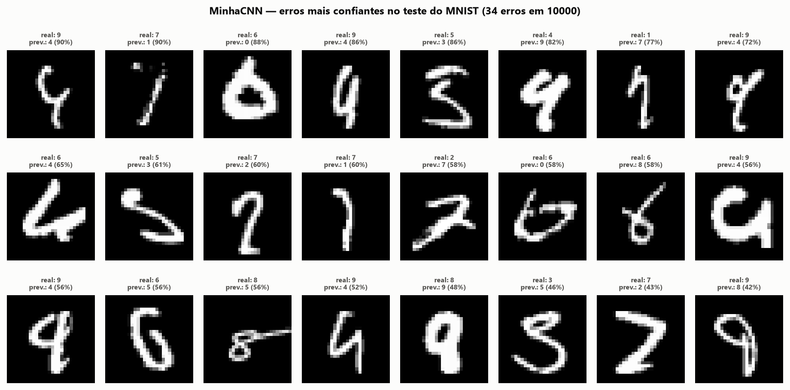
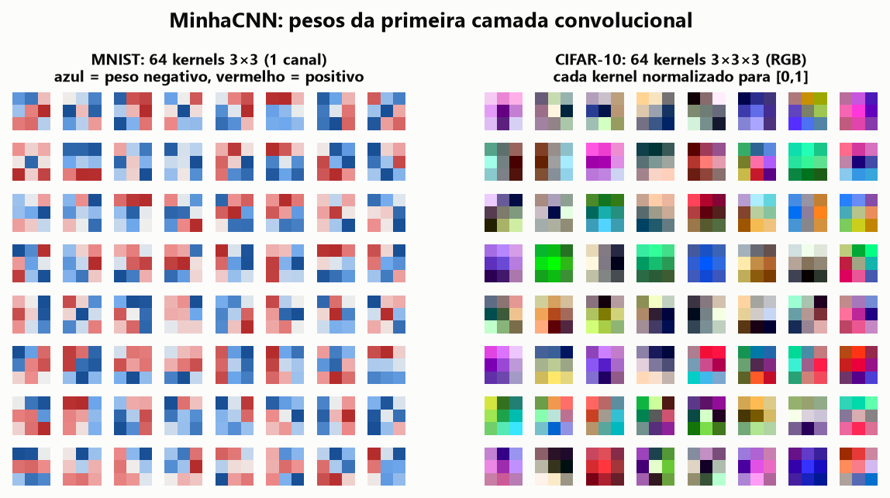
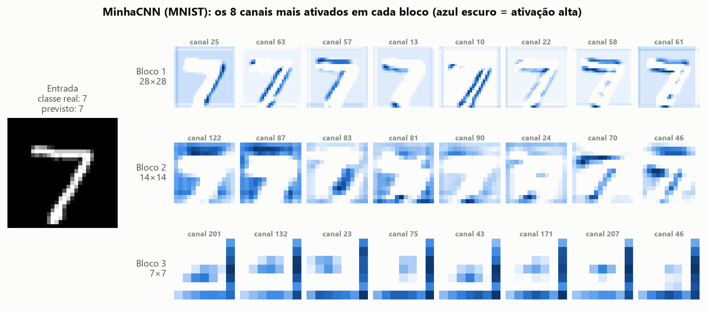
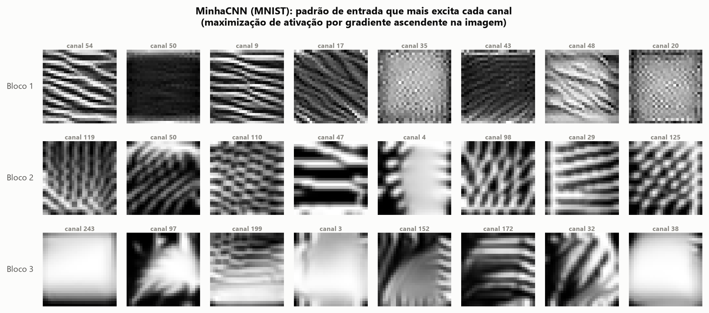
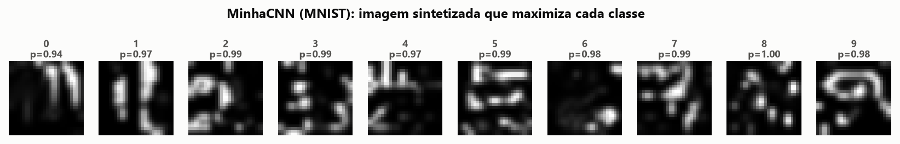
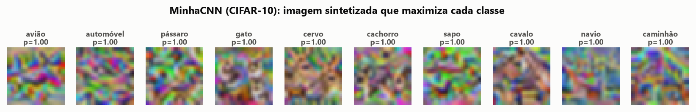

# Redes Neurais Convolucionais no MNIST e no CIFAR-10: CNN própria x ResNet18 pré-treinada

{{subtitle}}Introdução à Aprendizagem Profunda — Atividade Prática Supervisionada (APS)

{{subtitle}}Implementação de Redes Convolucionais

{{subtitle}}**Integrantes:** _(preencher com os nomes do grupo)_

{{subtitle}}**Repositório:** _(preencher com o link do GitHub)_

{{subtitle}}Outubro de 2026

{{pagebreak}}

## Resumo

Implementamos em PyTorch uma CNN própria (**MinhaCNN**, 1,18 milhão de parâmetros, com Batch Normalization, dropout, weight decay, aumento de dados e label smoothing), treinada do zero, e a comparamos com a **ResNet18 pré-treinada no ImageNet** (11,2 milhões de parâmetros) no MNIST e no CIFAR-10.

- **MNIST:** a MinhaCNN obteve **99,66%** de acurácia no teste e a ResNet18 com *fine-tuning*, **99,53%**. A MinhaCNN foi ligeiramente melhor (13 erros a menos em 10.000 imagens; diferença pequena, mas significativa a 5% pelo teste de McNemar, p = 0,041): o problema está quase resolvido pelas duas.
- **CIFAR-10:** a ResNet18 com *fine-tuning* obteve **95,46%**, contra **92,43%** da MinhaCNN (40% menos erros). A vantagem vem principalmente do **pré-treino**: a mesma ResNet18 treinada do zero, no mesmo protocolo, ficou em 86,92%.
- A MinhaCNN é **9,5× menor** e faz inferência **12× mais rápido** (19.235 contra 1.567 imagens/s). A regularização foi decisiva para ela: sem regularização a acurácia no CIFAR-10 cai para 86,17%, com 100% no treino (*overfitting*).
- No desafio, as visualizações mostram a hierarquia esperada: bordas e cores na 1ª camada, texturas no meio e, no último bloco, neurônios que respondem a objetos de uma única classe (carros, rostos de cachorro, pássaros, caminhões).

## 1. Introdução e objetivo

Na atividade anterior implementamos um perceptron multicamadas (MLP). Um MLP trata a imagem como um vetor: cada pixel se liga a todos os neurônios da camada seguinte, a rede não sabe que pixels vizinhos estão relacionados e precisa reaprender o mesmo padrão em cada posição. As redes convolucionais (CNNs) resolvem isso com três ideias: **conectividade local** (cada neurônio olha uma pequena janela), **compartilhamento de pesos** (o mesmo kernel percorre a imagem inteira, então um detector de borda funciona em qualquer posição) e **hierarquia** (camadas mais profundas combinam padrões simples em padrões complexos, com o *pooling* aumentando o campo receptivo).

O objetivo deste trabalho é:

1. implementar uma CNN própria em PyTorch, com técnicas de regularização, e treiná-la do zero no MNIST e no CIFAR-10;
2. comparar seu desempenho preditivo com uma rede pré-treinada conhecida — a **ResNet18** treinada no ImageNet, disponível no `torchvision`;
3. explicar as razões das diferenças observadas e propor melhorias para a nossa CNN;
4. (desafio) visualizar os kernels e as ativações para entender o que cada neurônio aprende.

## 2. Conjuntos de dados

| | MNIST | CIFAR-10 |
|---|---|---|
| Conteúdo | dígitos manuscritos 0–9 | objetos em 10 classes (avião, automóvel, pássaro, gato, cervo, cachorro, sapo, cavalo, navio, caminhão) |
| Imagens | 28×28, tons de cinza | 32×32, coloridas (RGB) |
| Treino / teste oficiais | 60.000 / 10.000 | 50.000 / 10.000 |
| Divisão usada (treino / validação / teste) | 55.000 / 5.000 / 10.000 | 45.000 / 5.000 / 10.000 |
| Fonte | Hugging Face `ylecun/mnist` (Parquet) | Krizhevsky (2009), espelho oficial `uoft-cs/cifar10` no Hugging Face |

As 5.000 imagens de validação foram sorteadas do treino oficial com semente fixa. A validação foi usada para acompanhar o treino e escolher o melhor checkpoint (*early stopping* por seleção de época); o **conjunto de teste só foi usado uma vez, no final**, para os números reportados.

O MNIST é um problema "fácil": fundo uniforme, objeto centralizado e normalizado em tamanho. O CIFAR-10 é bem mais difícil: imagens pequenas de objetos reais, com fundo variado, mudanças de pose, escala e iluminação, e classes visualmente próximas (gato x cachorro, automóvel x caminhão).

Usamos o espelho do CIFAR-10 no Hugging Face por ser muito mais rápido de baixar, mas também baixamos a versão binária original de Toronto e conferimos por *hash* que os dois contêm exatamente as mesmas 60.000 imagens e rótulos (o conjunto de teste é idêntico inclusive na ordem; o de treino está apenas em outra ordem).

## 3. Metodologia

### 3.1 Arquitetura da CNN própria (MinhaCNN)

A MinhaCNN segue o estilo VGG: três blocos com duas convoluções 3×3 cada, seguidas de *max-pooling* 2×2 e *dropout* espacial. O número de filtros dobra a cada bloco (64 → 128 → 256) enquanto a resolução cai pela metade. No final, um *Global Average Pooling* (GAP) resume cada mapa de características em um número, e uma pequena cabeça MLP — a mesma ideia da atividade anterior — faz a classificação. A mesma arquitetura é usada nos dois conjuntos; só muda o número de canais de entrada (1 no MNIST, 3 no CIFAR-10).

| Camada | Saída (CIFAR-10) | Saída (MNIST) | Parâmetros |
|---|---|---|---:|
| Conv 3×3, 64 + BN + ReLU | 64×32×32 | 64×28×28 | 1.856 (704 no MNIST) |
| Conv 3×3, 64 + BN + ReLU | 64×32×32 | 64×28×28 | 36.992 |
| MaxPool 2×2 + Dropout2d (p=0,1) | 64×16×16 | 64×14×14 | 0 |
| Conv 3×3, 128 + BN + ReLU | 128×16×16 | 128×14×14 | 73.984 |
| Conv 3×3, 128 + BN + ReLU | 128×16×16 | 128×14×14 | 147.712 |
| MaxPool 2×2 + Dropout2d (p=0,1) | 128×8×8 | 128×7×7 | 0 |
| Conv 3×3, 256 + BN + ReLU | 256×8×8 | 256×7×7 | 295.424 |
| Conv 3×3, 256 + BN + ReLU | 256×8×8 | 256×7×7 | 590.336 |
| MaxPool 2×2 + Dropout2d (p=0,2) | 256×4×4 | 256×3×3 | 0 |
| Global Average Pooling | 256 | 256 | 0 |
| Linear 256→128 + BN + ReLU + Dropout (p=0,3) | 128 | 128 | 33.024 |
| Linear 128→10 | 10 | 10 | 1.290 |
| **Total** | | | **1.180.618** (1.179.466 no MNIST) |

O GAP no lugar de "achatar" o mapa 256×4×4 reduz muito o número de parâmetros da parte densa (33 mil em vez de mais de 500 mil) e já funciona como regularizador.

### 3.2 Técnicas de regularização

- **Batch Normalization** após cada convolução: estabiliza e acelera o treino e adiciona um leve ruído de regularização (estatísticas por lote).
- **Dropout espacial (Dropout2d)** ao fim de cada bloco: desliga canais inteiros, forçando redundância entre os detectores; **Dropout** comum (p=0,3) na cabeça densa.
- **Weight decay** (L2, 5×10⁻⁴) nos pesos das convoluções e camadas lineares (não em BN e vieses).
- **Aumento de dados (data augmentation)**, feito na GPU: no CIFAR-10, recorte aleatório com *padding* de 4 pixels e espelhamento horizontal; no MNIST, pequenas rotações (±10°), translações (±8%) e escalas (0,9–1,1) — sem espelhamento, que trocaria o significado de alguns dígitos.
- **Label smoothing** (0,1): o alvo da classe correta passa a ser 0,91 em vez de 1, desencorajando a rede de ficar confiante demais.
- **Seleção do melhor checkpoint pela validação** (equivalente a *early stopping*).

Para medir o efeito dessas técnicas, treinamos também uma **ablação**: a mesma MinhaCNN no CIFAR-10, com o mesmo número de épocas, mas sem aumento de dados, sem dropout, sem weight decay e sem label smoothing (mantivemos a BN, necessária para a estabilidade do treino).

### 3.3 Treinamento

Otimizador SGD com momento de Nesterov (0,9), lotes de 128 imagens e política de taxa de aprendizado *One-Cycle* (sobe até o máximo nos primeiros 25% do treino e depois decai suavemente), com precisão mista (fp16) para acelerar. A MinhaCNN foi treinada por 15 épocas no MNIST e 40 no CIFAR-10, com taxa máxima de 0,1.

### 3.4 Rede pré-treinada: ResNet18 (ImageNet)

Escolhemos a **ResNet18** (He et al., 2016) com os pesos `IMAGENET1K_V1` do `torchvision`. Ela usa conexões residuais (atalhos que somam a entrada de um bloco à sua saída), o que facilita o fluxo do gradiente e permite redes profundas. Entre as opções sugeridas, é a de melhor custo-benefício para a nossa GPU de 6 GB: a VGG16 tem 138 milhões de parâmetros e a ResNet50, 25 milhões, contra 11,2 milhões da ResNet18; a AlexNet é mais antiga e menos precisa no ImageNet.

Adaptação aos nossos dados: a imagem é ampliada por interpolação bilinear para **224×224** (a resolução em que a rede foi pré-treinada), o MNIST em tons de cinza é replicado nos 3 canais, aplica-se a normalização do ImageNet e a última camada (1000 classes) é trocada por uma nova camada linear 512→10. O aumento de dados é o mesmo da MinhaCNN, aplicado antes da ampliação.

Avaliamos três formas de usar a ResNet18:

1. **Fine-tuning completo:** todos os pesos são ajustados, partindo do ImageNet (taxa máxima 0,01, weight decay 10⁻⁴; 5 épocas no CIFAR-10 e 3 no MNIST).
2. **Extração de características:** o *backbone* fica congelado e só a nova camada final é treinada (5 épocas, taxa 0,1). Mede o quanto as características do ImageNet já servem "como estão".
3. **Controle — ResNet18 do zero:** a mesma rede e a mesma resolução 224×224, mas com pesos aleatórios, 5 épocas no CIFAR-10. Isola o efeito do pré-treino do efeito da arquitetura.

### 3.5 Ambiente

Notebook com GPU NVIDIA GeForce RTX 3050 Laptop (6 GB), Windows 11, Python 3.11, PyTorch 2.7.1 com CUDA 12.6. Os dados ficam inteiros na memória da GPU e o aumento de dados é feito em lote na própria GPU, o que elimina o gargalo de carregamento.

## 4. Resultados

### 4.1 Visão geral

| Dataset | Modelo | Parâmetros (treináveis) | Épocas | Acurácia teste | F1 macro | Acc. treino | Gap | Tempo de treino | Inferência (img/s) |
|---|---|---:|---:|---:|---:|---:|---:|---:|---:|
| MNIST | MinhaCNN | 1,18 M | 15 | **99,66%** | 0,9966 | 99,82% | 0,2 p.p. | 2,1 min | 25.064 |
| MNIST | ResNet18 (fine-tuning) | 11,18 M | 3 | **99,53%** | 0,9953 | 99,71% | 0,2 p.p. | 5,8 min | 1.573 |
| MNIST | ResNet18 (extração) | 11,18 M (5.130) | 5 | 96,31% | 0,9627 | 96,59% | 0,3 p.p. | 3,8 min | 1.571 |
| CIFAR-10 | MinhaCNN | 1,18 M | 40 | **92,43%** | 0,9240 | 98,16% | 5,7 p.p. | 6,1 min | 19.235 |
| CIFAR-10 | ResNet18 (fine-tuning) | 11,18 M | 5 | **95,46%** | 0,9545 | 98,68% | 3,2 p.p. | 8,0 min | 1.567 |
| CIFAR-10 | ResNet18 (extração) | 11,18 M (5.130) | 5 | 86,97% | 0,8691 | 88,55% | 1,6 p.p. | 2,8 min | 1.568 |
| CIFAR-10 | ResNet18 do zero | 11,18 M | 5 | 86,92% | 0,8686 | 89,62% | 2,7 p.p. | 7,9 min | 1.568 |
| CIFAR-10 | MinhaCNN sem regularização | 1,18 M | 40 | 86,17% | 0,8616 | 100,00% | 13,8 p.p. | 6,0 min | 19.043 |

*Acc. treino* é a acurácia no conjunto de treino sem aumento de dados nem dropout, e *Gap* é a diferença entre ela e a acurácia de teste (medida de *overfitting*). Tempos medidos na RTX 3050 Laptop; inferência em lotes de 256 imagens com fp16.

Com 10.000 imagens de teste, o intervalo de confiança de 95% da acurácia é de cerca de ±0,1 ponto percentual (p.p.) no MNIST e ±0,5 p.p. no CIFAR-10. Para comparar os modelos usamos o **teste de McNemar**, que olha as imagens em que um modelo acerta e o outro erra: no CIFAR-10, das imagens em que só um dos dois acerta, 479 são acertos só da ResNet18 e 176 só da MinhaCNN (p < 0,001: diferença **significativa**); no MNIST, são 24 acertos só da MinhaCNN contra 11 só da ResNet18 (p = 0,041: diferença significativa ao nível de 5%, embora pequena em termos absolutos).

### 4.2 Curvas de aprendizado

A ResNet18 pré-treinada atinge 91,8% de validação no CIFAR-10 após **uma única época**, enquanto a MinhaCNN leva cerca de 25 épocas para chegar a 87%. A ResNet não está aprendendo a "ver" do zero: ela só reajusta características que já sabe extrair. A MinhaCNN ainda estava melhorando no fim do treino (melhor época: 39 de 40).

### 4.3 CIFAR-10: onde cada rede erra

As redes têm o mesmo padrão de dificuldade: **gato**, **pássaro** e **cachorro** são as classes mais difíceis e os veículos, as mais fáceis. A maior vantagem da ResNet18 está justamente nos animais — pássaro (+7,6 p.p.), gato (+5,9 p.p.) e cachorro (+3,4 p.p.) —, enquanto em automóvel e caminhão a diferença é de 0,4 a 1,4 p.p. Não é coincidência: o ImageNet tem centenas de classes de animais (só de raças de cachorro são mais de cem), então a ResNet chega ao CIFAR-10 já sabendo distinguir pelagem, focinho e orelhas.

A confusão dominante é **gato → cachorro** (9,1% dos gatos na MinhaCNN) e, no sentido contrário, cachorro → gato; em seguida vêm automóvel ↔ caminhão e avião ↔ navio (fundos de céu e de água parecidos).

### 4.4 MNIST

No MNIST as redes erram só 34 (MinhaCNN) e 47 (ResNet18 com fine-tuning) das 10.000 imagens de teste. Boa parte dos erros restantes são dígitos mal escritos ou com rótulo discutível, então há pouco espaço real para melhoria.

### 4.5 Custo computacional

Por época, a ResNet18 a 224×224 é cerca de 10× mais lenta que a MinhaCNN (91 s contra 9 s) e, na inferência, 12× mais lenta. Como converge em poucas épocas, o tempo total de treino acaba parecido (8,0 contra 6,1 minutos), mas o custo de usar o modelo continua 12× maior. A ampliação de 32×32 para 224×224 multiplica por 49 o número de pixels processados.

### 4.6 Efeito da regularização (ablação)

| MinhaCNN no CIFAR-10 | Acurácia de teste | Acurácia de treino | Gap | Perda de teste |
|---|---:|---:|---:|---:|
| Com regularização | 92,43% | 98,16% | 5,7 p.p. | 0,303 |
| Sem regularização | 86,17% | 100,00% | 13,8 p.p. | 0,765 |

Sem regularização a rede memoriza o treino em ~20 épocas e deixa de generalizar: a perda de teste fica 2,5× maior e a acurácia cai 6,3 p.p. A regularização reduziu o gap a menos da metade e rendeu mais do que a diferença entre a MinhaCNN e a ResNet18.

## 5. Discussão: por que esses resultados?

**1. O pré-treino é a principal vantagem da ResNet18 no CIFAR-10.** A ResNet18 viu 1,28 milhão de imagens do ImageNet antes do CIFAR-10; a MinhaCNN viu só 45 mil. O experimento de controle isola esse efeito: a **mesma ResNet18**, na mesma resolução e com o mesmo número de épocas, mas partindo de pesos aleatórios, ficou em **86,92%**, contra 95,46% com pré-treino. Não é a arquitetura nem o tamanho da rede que explicam a diferença — é o conhecimento transferido. As camadas iniciais aprendidas no ImageNet (bordas, cores, texturas) são genéricas e servem para qualquer imagem natural (Yosinski et al., 2014); só as finais precisam ser reajustadas.

**2. Extração de características x fine-tuning.** Congelando o *backbone* e treinando só a última camada, a ResNet18 obteve 86,97% no CIFAR-10 e 96,31% no MNIST. A extração de características fica 8,5 p.p. abaixo do fine-tuning no CIFAR-10 e 3,2 p.p. abaixo no MNIST. As características do ImageNet já separam razoavelmente animais e veículos, mas foram aprendidas em fotos coloridas de alta resolução, não em traços de dígitos ampliados de 28×28 — por isso o MNIST é o que mais precisa que o *backbone* seja reajustado. Mesmo treinando só 5.130 parâmetros (a camada final), a extração chega a 86,97% no CIFAR-10, abaixo da MinhaCNN treinada do zero; o fine-tuning completo, que adapta também as camadas intermediárias, é o que leva a ResNet18 além da MinhaCNN.

**3. O CIFAR-10 se parece com o ImageNet; o MNIST, não.** As classes do CIFAR-10 (animais e veículos) existem no ImageNet, e por isso o ganho do pré-treino é maior justamente nos animais (seção 4.3). Dígitos brancos sobre fundo preto não se parecem com fotos: no MNIST o pré-treino não trouxe vantagem, e a MinhaCNN, menor e treinada direto na resolução original, foi até ligeiramente melhor que a ResNet18.

**4. Capacidade e resolução.** A ResNet18 tem 9,5× mais parâmetros, 18 camadas com atalhos residuais e processa a imagem ampliada para 224×224. A ampliação não cria informação nova, mas casa a escala dos objetos com a que os filtros pré-treinados esperam. O preço é o custo: 12× mais lenta na inferência.

**5. O MNIST está saturado.** Com erros abaixo de 0,5%, as diferenças entre modelos são de poucas dezenas de imagens (p = 0,041 entre MinhaCNN e ResNet18, no limite da significância). O que sobra são dígitos ambíguos, que nenhuma arquitetura resolve.

**6. Viés indutivo da convolução e regularização.** Mesmo pequena, a MinhaCNN chega a 92% no CIFAR-10 — bem acima do que um MLP costuma atingir nesse conjunto (na faixa de 50–60%) — porque a convolução embute duas suposições corretas sobre imagens: padrões são locais e podem aparecer em qualquer posição. Mas, treinada do zero em poucos dados, ela depende de regularização forte para não decorar o treino (seção 4.6).

## 6. Como melhorar o desempenho da MinhaCNN

As propostas abaixo estão ordenadas pelo que esperamos ser a melhor relação ganho/esforço no CIFAR-10 (no MNIST há pouco espaço: o erro já está perto do limite de rótulos ambíguos).

1. **Treinar por mais tempo.** A MinhaCNN ainda melhorava na época 40 (melhor época: 39) e o gap treino-teste é moderado (5,7 p.p.), sinais de que ela não saturou. Receitas comuns para CIFAR-10 usam de 100 a 200 épocas.
2. **Aumento de dados mais forte.** *Cutout*/*Random Erasing* (apagar um quadrado aleatório da imagem), RandAugment/AutoAugment e *MixUp*/*CutMix* (misturar pares de imagens e rótulos) atacam justamente as confusões entre classes parecidas e costumam render de 1 a 3 pontos percentuais no CIFAR-10 em redes desse porte.
3. **Conexões residuais e mais profundidade/largura.** Transformar cada bloco em um bloco residual (como na ResNet) permite empilhar mais camadas sem degradar o treino. Uma ResNet18 adaptada para 32×32 (primeira convolução 3×3 sem *stride* e sem o *max-pool* inicial), treinada do zero com receita longa, chega a cerca de 95% no CIFAR-10.
4. **Destilação de conhecimento.** Usar a ResNet18 *fine-tuned* (o "professor") para gerar rótulos suaves e treinar a MinhaCNN (o "aluno") para imitá-los (Hinton et al., 2015). O aluno herda parte do conhecimento do ImageNet mantendo o custo de inferência baixo — exatamente o *trade-off* que este trabalho evidencia.
5. **Pré-treino.** Pré-treinar a MinhaCNN em um conjunto maior (por exemplo, um subconjunto do ImageNet reduzido a 32×32) ou com aprendizado auto-supervisionado, e depois fazer *fine-tuning*.
6. **Truques de avaliação e otimização.** Média exponencial dos pesos (EMA) ou SWA, *test-time augmentation* (média das previsões da imagem original e espelhada), *ensemble* de algumas MinhaCNNs (cada uma custa ~6 minutos), otimizadores como SAM, e uma busca sistemática de hiperparâmetros (taxa de aprendizado, weight decay, taxas de dropout) usando a validação.
7. **Mais resolução de entrada.** Parte da vantagem da ResNet vem de processar a imagem ampliada; a MinhaCNN poderia usar 64×64 com um bloco a mais, ao custo de ~4× mais computação.

## 7. Desafio: o que os kernels e os neurônios aprendem

Usamos cinco técnicas complementares (todas em `src/activations.py`): (1) os pesos da primeira camada, (2) os mapas de ativação de cada bloco para uma imagem, (3) a maximização de ativação — sintetizar, por gradiente ascendente, a imagem que mais excita um canal (Erhan et al., 2009) —, (4) as imagens reais do teste que mais ativam cada canal (Zeiler e Fergus, 2014) e (5) o Grad-CAM, que mostra quais regiões pesaram na decisão (Selvaraju et al., 2017).

### 7.1 Kernels da primeira camada

Kernels 3×3 são pequenos demais para mostrar formas, mas o padrão é claro: no MNIST, quase todos combinam pesos positivos (vermelho) e negativos (azul) em lados opostos — respondem à transição claro/escuro de uma borda numa direção específica. No CIFAR-10, parte dos kernels responde a cores (verde, magenta, azul) e parte a contrastes de luminosidade.

Os kernels 7×7 da ResNet18 mostram o resultado clássico: filtros de bordas orientadas parecidos com filtros de Gabor e detectores de cores oponentes (verde × magenta, azul × amarelo) — o mesmo tipo de detector encontrado no córtex visual primário. Após o fine-tuning, eles mudaram só **3,3%** (norma relativa): as primeiras camadas são genéricas e quase não precisam de ajuste, o que explica por que o pré-treino transfere tão bem.

### 7.2 Mapas de ativação

Vemos a hierarquia típica das CNNs: o bloco 1 funciona como um banco de detectores de bordas (cada canal acende para uma orientação — no "7", um canal pega só o traço horizontal, outro só a diagonal); conforme a resolução cai, as ativações ficam mais esparsas e abstratas, e no bloco 3 cada canal responde a uma região do objeto. Um efeito curioso no MNIST: vários canais do bloco 3 respondem à **borda da imagem**. O *zero-padding* das convoluções deixa a borda "visível" para a rede, que a usa como referência de posição — fenômeno descrito por Islam et al. (2020).

### 7.3 O padrão que cada neurônio procura (maximização de ativação)

Partindo de ruído, ajustamos os pixels da imagem para maximizar a ativação média de um canal (antes da ReLU), com regularização de suavidade (variação total, desfoque e pequenos deslocamentos aleatórios) para obter padrões legíveis. A complexidade cresce com a profundidade: no bloco 1 os canais querem só uma cor ou uma orientação de borda; no bloco 2, listras curvas e texturas; no bloco 3, padrões mais elaborados que lembram partes de objetos.

Quando maximizamos a saída de cada classe, alguns traços aparecem (um traço vertical para o "1", um laço para o "9", tons de pelagem marrom para cervo e cavalo), mas a rede atinge 98–100% de confiança com imagens que não se parecem com os objetos. Isso mostra que a rede decide com base em combinações de texturas e partes locais, e não numa "forma global" como nós — a mesma fragilidade explorada pelos exemplos adversariais.

### 7.4 Imagens reais que mais ativam cada neurônio

Esta é a visualização mais interpretável. Para cada um dos 256 canais do bloco 3 pegamos as 50 imagens de teste com maior ativação e medimos a fração que pertence à classe mais comum. Os 6 canais mostrados têm **100%** das 50 imagens de uma mesma classe — o canal 60, por exemplo, responde a rostos de cachorro vistos de frente; o 201 e o 70, a carros (de frente e de lado); o 187, a caminhões. Na média dos 256 canais, **75,8%** das imagens de topo são da mesma classe. A rede nunca recebeu a instrução "detecte rostos de cachorro" — só os rótulos das imagens —, mas aprendeu sozinha detectores de partes e de objetos no último bloco.

### 7.5 Para onde cada rede olha (Grad-CAM)

O Grad-CAM pondera os mapas do último bloco pelo gradiente da classe prevista. A MinhaCNN baseia a decisão em regiões pequenas e muito discriminativas — o olho e o cabresto do cavalo, o focinho do cachorro, o corpo do avião —, enquanto a ResNet18 distribui a atenção pelo objeto inteiro (o gato todo, o corpo do sapo). No pássaro (um avestruz de frente), a MinhaCNN olhou só o bico, que lembra uma grade de carro, e errou para "automóvel"; a ResNet18, olhando a cabeça inteira, acertou. Depender de poucas pistas locais torna a rede menor mais frágil a oclusões e fundos enganosos, e é coerente com o que vimos na maximização de classes.

## 8. Conclusão

A CNN implementada pelo grupo, com 1,18 milhão de parâmetros e treinada do zero em ~6 minutos, atingiu **99,66%** no MNIST e **92,43%** no CIFAR-10. A ResNet18 pré-treinada no ImageNet ficou ligeiramente atrás no MNIST (99,53%) e foi melhor no CIFAR-10 (**95,46%**), com a vantagem concentrada nas classes de animais. Os experimentos de controle mostram que essa vantagem vem do **conhecimento transferido do ImageNet**, e não da arquitetura em si: a mesma ResNet18 sem pré-treino ficou em 86,92%. Em contrapartida, a MinhaCNN é 9,5× menor e 12× mais rápida na inferência, e a regularização foi essencial para ela (+6,3 p.p. no CIFAR-10).

As visualizações confirmam a teoria vista em aula: as CNNs aprendem uma hierarquia de características — bordas e cores, depois texturas e partes, e por fim detectores de objetos — e as primeiras camadas são tão genéricas que quase não mudam no fine-tuning. Os caminhos mais promissores para melhorar a MinhaCNN são treinar por mais tempo com aumento de dados mais forte, adicionar conexões residuais e usar destilação a partir da própria ResNet18.

## 9. Reprodutibilidade e repositório

Todo o código está no repositório do grupo _(link)_. Estrutura principal:

| Arquivo | Função |
|---|---|
| `run_all.py` | executa todos os experimentos em sequência e gera as figuras |
| `download_data.py` | baixa MNIST e CIFAR-10 para `data/raw/` |
| `src/data.py` | leitura dos dados, divisão treino/validação/teste, aumento de dados na GPU |
| `src/models.py` | MinhaCNN e ResNet18 (torchvision) |
| `src/train.py` | treino e avaliação de um experimento (linha de comando) |
| `src/plots.py` | gráficos e tabela-resumo (`results/resumo.csv`) |
| `src/activations.py` | desafio: kernels, mapas de ativação, maximização de ativação, Grad-CAM |
| `src/make_report.py` | gera este relatório em DOCX e PDF a partir do Markdown |

Para reproduzir: `pip install -r requirements.txt`, depois `python download_data.py` e `python run_all.py` (cerca de 1 hora numa RTX 3050 Laptop). Cada experimento grava em `results/<nome>/` o histórico por época (`history.json`), as métricas finais (`metrics.json`) e as previsões no teste (`test_preds.npz`); os logs ficam em `logs/`. As sementes aleatórias são fixas, mas o uso de `cudnn.benchmark` e de precisão mista pode causar variações pequenas (da ordem de décimos de ponto percentual) entre execuções.

## Referências

- DEVRIES, T.; TAYLOR, G. W. Improved Regularization of Convolutional Neural Networks with Cutout. arXiv:1708.04552, 2017.
- ERHAN, D. et al. Visualizing Higher-Layer Features of a Deep Network. Universidade de Montreal, Relatório Técnico 1341, 2009.
- HE, K. et al. Deep Residual Learning for Image Recognition. CVPR, 2016.
- HINTON, G.; VINYALS, O.; DEAN, J. Distilling the Knowledge in a Neural Network. arXiv:1503.02531, 2015.
- IOFFE, S.; SZEGEDY, C. Batch Normalization: Accelerating Deep Network Training by Reducing Internal Covariate Shift. ICML, 2015.
- ISLAM, M. A.; JIA, S.; BRUCE, N. D. B. How Much Position Information Do Convolutional Neural Networks Encode? ICLR, 2020.
- KORNBLITH, S.; SHLENS, J.; LE, Q. V. Do Better ImageNet Models Transfer Better? CVPR, 2019.
- KRIZHEVSKY, A. Learning Multiple Layers of Features from Tiny Images. Universidade de Toronto, 2009.
- LECUN, Y. et al. Gradient-Based Learning Applied to Document Recognition. Proceedings of the IEEE, 1998.
- SELVARAJU, R. R. et al. Grad-CAM: Visual Explanations from Deep Networks via Gradient-Based Localization. ICCV, 2017.
- SIMONYAN, K.; ZISSERMAN, A. Very Deep Convolutional Networks for Large-Scale Image Recognition. ICLR, 2015.
- SMITH, L. N.; TOPIN, N. Super-Convergence: Very Fast Training of Neural Networks Using Large Learning Rates. 2019.
- SRIVASTAVA, N. et al. Dropout: A Simple Way to Prevent Neural Networks from Overfitting. JMLR, 2014.
- SZEGEDY, C. et al. Rethinking the Inception Architecture for Computer Vision (label smoothing). CVPR, 2016.
- TOMPSON, J. et al. Efficient Object Localization Using Convolutional Networks (Spatial Dropout). CVPR, 2015.
- YOSINSKI, J. et al. How Transferable Are Features in Deep Neural Networks? NeurIPS, 2014.
- ZEILER, M. D.; FERGUS, R. Visualizing and Understanding Convolutional Networks. ECCV, 2014.
- ZHANG, H. et al. mixup: Beyond Empirical Risk Minimization. ICLR, 2018.
